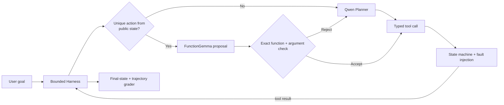

English | [中文](README.zh-CN.md)

# DeviceAgent Arena

**An auditable harness, post-training pipeline, and compound-agent experiment for
stateful Chinese Tool-Use agents.**

DeviceAgent Arena evaluates more than mapping a user utterance to a function name.
An agent must react to multi-turn observations, clarify missing information, confirm
shared impact, bind cross-domain outputs, recover ambiguous writes, wait for user-side
actions, and stop safely when a goal is infeasible. Success is graded from the final
world state and the complete trajectory, never from the model's own claim.

## V2.7 headline result

`FunctionGemma-270M proposal -> exact public-state validator -> Qwen3-1.7B fallback -> Harness execution`

| Metric | Qwen Direct | Compound Agent | Change |
|---|---:|---:|---:|
| Safe Strict | 22/36 (61.1%) | **31/36 (86.1%)** | **+25.0 pp** |
| Paired win / tie / loss | -- | **9 / 27 / 0** | no task-level regression |
| Safe Execution | 34/36 | 34/36 | unchanged |
| Qwen Planner calls | 261 | **172** | **-34.1%** |
| End-to-end P95 latency | 59.4 s | **49.0 s** | **-17.6%** |

Safe Strict requires goal completion, safe execution, protocol-compliant trajectory,
legal calls, and correct termination. The 95% task-level paired-bootstrap descriptive
interval for the difference is **+11.1 to +38.9 percentage points**.

> **Evidence scope:** Dev19-54 were excluded from training and repair but share Train
> instruction templates. This is not an external sealed test or production rate.
> Total model calls rose 12.6%, input tokens rose 9.9%, and two of 36 tasks still
> violated a minefield boundary. A deterministic fast-path-without-FunctionGemma
> ablation is still missing.

## Architecture



The first stage trained the Qwen Planner on 1,920 Train-only next-decision records.
After real rollouts, 53 deviation states were extracted from 10 failed Train tasks,
producing 1,202 correction, oracle, recovery, and replay records. The refinement used
Qwen3-1.7B NF4 QLoRA with `r=16 / alpha=32 / dropout=0.05 / all-linear`, effective
batch size 8, one epoch, and 151 optimizer updates. Peak allocated RTX 4060 memory was
4,926.8MB. See [the V2.7 architecture](docs/ARCHITECTURE_V2_7.md).

## Quick verification

```text
python -m pip install -e ".[dev]"
python -m pytest -q
python -m ruff check .
device-agent-arena-v2 validate-composition-suite --suite-root data/v2/deviceops-ul-v2-composition-v0.1
python tools/public_release.py --project-root . audit
```

See [Reproducing V2.7](docs/REPRODUCING_V2_7.md) for evidence replay, model reruns,
training prerequisites, and expected outputs.

## Evidence and public release

- [V2.7 experiment report](docs/V2_7_LAYERED_EXPERIMENT_REPORT.md)
- [Architecture and trust boundaries](docs/ARCHITECTURE_V2_7.md)
- [Reproduction guide](docs/REPRODUCING_V2_7.md)
- [Research history and negative results](docs/RESEARCH_HISTORY.md)
- [Machine-readable release manifest](artifacts/v2/layered/release-manifest-v2.7.json)

The complete local workspace retains historical data and checkpoints. A public tree
is generated from an explicit allowlist:

```text
python tools/public_release.py --project-root . audit
python tools/public_release.py --project-root . export ../device-agent-arena-public
```

The exporter never deletes or overwrites its destination and rejects model weights,
oversized files, local absolute paths, and common credential patterns. Project code
and selected synthetic data use [Apache-2.0](LICENSE); model weights are excluded and
FunctionGemma remains subject to the Google Gemma terms. See [NOTICE](NOTICE).

## Limitations

- The environment is a deterministic text simulator, not a real Android/iOS UI or
  visual-control stack.
- Dev36 is small; its interval describes only those 36 tasks.
- Latency comes from one sequential run per condition on an RTX 4060, without
  interleaved repetitions.
- The evidence supports fewer expensive Planner calls and better closed-loop
  completion, not lower total cost or solved safety.
