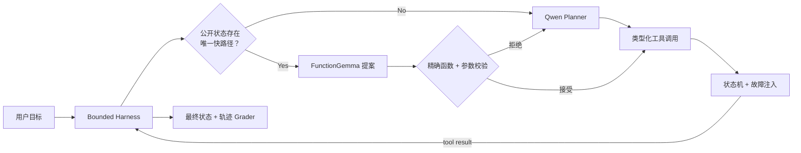

[English](README.md) | 中文

# DeviceAgent Arena

**面向有状态中文 Tool-Use Agent 的可复核 Harness、后训练与 Compound Agent 实验。**

本项目不只评“用户文本映射到函数名”，而是让 Agent 在多轮工具回执中处理
澄清与确认、跨域依赖、异步写入、幂等恢复、用户侧操作和不可行终止。
评分对象是**完整轨迹和最终世界状态**，不采信模型自报的成功。

## V2.7 核心结果

`FunctionGemma-270M 快路径提案 → 精确公开状态校验 → Qwen3-1.7B Planner 回退 → Harness 执行`

| 指标 | Qwen Direct | Compound Agent | 变化 |
|---|---:|---:|---:|
| Safe Strict | 22/36（61.1%） | **31/36（86.1%）** | **+25.0 pp** |
| 配对胜 / 平 / 负 | — | **9 / 27 / 0** | 无逐题退化 |
| Safe Execution | 34/36 | 34/36 | 持平 |
| Qwen Planner 调用 | 261 | **172** | **-34.1%** |
| 端到端 P95 延迟 | 59.4 s | **49.0 s** | **-17.6%** |

Safe Strict 同时要求目标完成、执行安全、轨迹合规、工具调用合法且终止正确。
配对差值的 95% task-level bootstrap 描述区间为 **+11.1～+38.9 pp**。

> **证据边界：**Dev19–54 未参与训练或修复，但与 Train 共享指令模板；它不是外部
> sealed Test 或线上成功率。总模型调用增加 12.6%、输入 token 增加 9.9%，仍有 2/36
> minefield violation；当前还缺纯确定性快路径消融。

## 架构



第一阶段用 1,920 条 Train-only next-decision 数据训练 Qwen Planner；真实 rollout 后从
10 条失败任务定位 53 个偏离状态，生成包含纠错、oracle、recovery 和 replay 的
1,202 条精修记录。精修采用 Qwen3-1.7B NF4 QLoRA：`r=16 / alpha=32 / dropout=0.05 /
all-linear`，有效 batch size 8，1 epoch，151 updates，RTX 4060 峰值已分配显存 4,926.8MB。

完整设计见 [V2.7 架构](docs/ARCHITECTURE_V2_7.md)。

## 快速验证

```text
python -m pip install -e ".[dev]"
python -m pytest -q
python -m ruff check .
device-agent-arena-v2 validate-composition-suite --suite-root data/v2/deviceops-ul-v2-composition-v0.1
python tools/public_release.py --project-root . audit
```

从 raw trajectory 重算主结果、模型重跑与重训要求见 [V2.7 复现指南](docs/REPRODUCING_V2_7.md)。

## 证据与发布

- [V2.7 中文实验报告](docs/V2_7_LAYERED_EXPERIMENT_REPORT.zh-CN.md)
- [架构与信任边界](docs/ARCHITECTURE_V2_7.md)
- [复现指南](docs/REPRODUCING_V2_7.md)
- [历史路线与负结果](docs/RESEARCH_HISTORY.md)
- [机器可读发布清单](artifacts/v2/layered/release-manifest-v2.7.json)

完整本地工作区保留历史数据和 checkpoint；可公开版通过显式白名单生成：

```text
python tools/public_release.py --project-root . audit
python tools/public_release.py --project-root . export ../device-agent-arena-public
```

导出器不删除或覆盖目标，并拒绝权重、超大文件、本机绝对路径与常见密钥格式。
项目代码和筛选合成数据使用 [Apache-2.0](LICENSE)；模型权重不包含在公开导出中，
FunctionGemma 仍受 Google Gemma 条款约束。详见 [NOTICE](NOTICE)。

## 局限

- 环境是确定性文本模拟器，不包含 Android/iOS UI、视觉定位和真实网络抖动。
- Dev36 规模较小，置信区间只描述这 36 个任务。
- 延迟来自 RTX 4060 上每个条件各一次顺序运行，没有多次交错重复。
- 当前证据支持“减少昂贵 Planner 调用并改善闭环成功”，不支持“总成本全面降低”或
  “安全问题已解决”。
