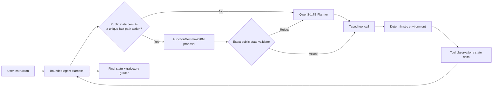

# DeviceAgent Arena V2.7 architecture

V2.7 evaluates a stateful Tool-Use Agent, not a one-shot function classifier. The
policy must react to tool observations, bind returned identifiers, wait for user-side
actions, recover from ambiguous writes, and stop safely when the goal is infeasible.

## Responsibilities

- **Harness:** owns the step budget, timeout, idempotency, tool execution, typed
  events, and complete raw trajectory. It never accepts the model's self-reported
  success as the grade.
- **Qwen Planner:** handles ambiguity, cross-domain dependencies, user confirmation,
  infeasibility, and recovery states that require open-ended planning.
- **FunctionGemma fast path:** proposes only three narrow transitions: re-inspection
  after a completed user action, polling after a submitted asynchronous write, and
  finishing after the target state is already verified.
- **Exact validator:** checks the proposed function and state-bound arguments against
  public observations. It does not read hidden goals or generate a fallback plan.
- **Environment and grader:** model a partially observable world with failure
  injection, then score both final state and trajectory constraints.

## Trust boundaries

Model text is untrusted input. Before execution, every proposal is parsed into a
typed call and validated against the active tool schema, argument schema, permissions,
public preconditions, and current episode. Model output never enters a shell, SQL,
HTML renderer, or arbitrary filesystem path.

The model sees only the user instruction, public tool definitions, conversation
history, and returned tool observations. Hidden goals, oracle plans, grader state,
and withheld generation secrets are excluded.

## Training path

The Qwen Planner uses completion-only next-decision QLoRA. A first Train-only stage
was followed by a refinement stage built from 10 failed Train tasks and 53 observed
deviation states. The refinement curriculum contains 1,202 records across 565 unique
prompts, mixing correction, failed-task oracle, recovery, and replay examples.

The final Qwen refinement uses NF4 4-bit loading, double quantization, BF16 compute,
LoRA `r=16`, `alpha=32`, `dropout=0.05`, all linear modules, effective batch size 8,
one epoch, and 151 optimizer updates on an RTX 4060 Laptop GPU.

## Evaluation contract

The headline comparison holds the Qwen Planner, Harness, task order, decoding,
source tree, and grading logic fixed. The only condition change is the speculative
FunctionGemma path plus exact validation and fallback. Dev19-54 are instance-held-out
but template-shared development tasks; they are not a sealed external test or an
estimate of production traffic.

See [the experiment report](V2_7_LAYERED_EXPERIMENT_REPORT.md) for the full protocol,
failure analysis, artifact hashes, and limitations.
